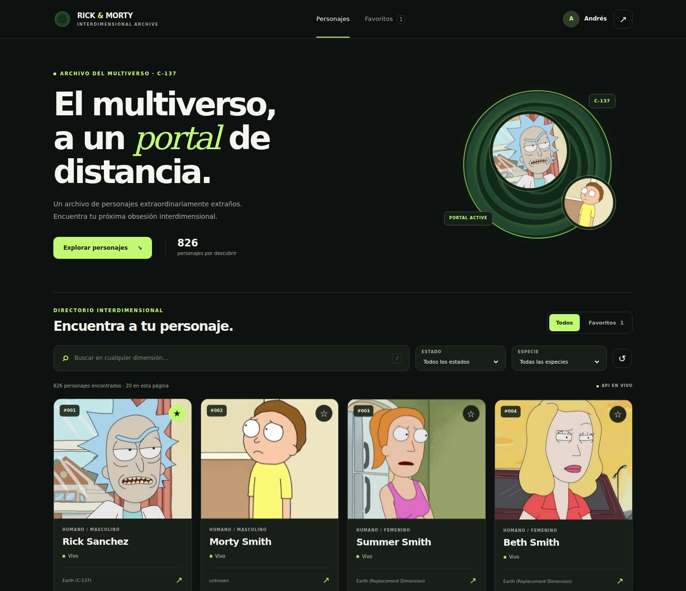
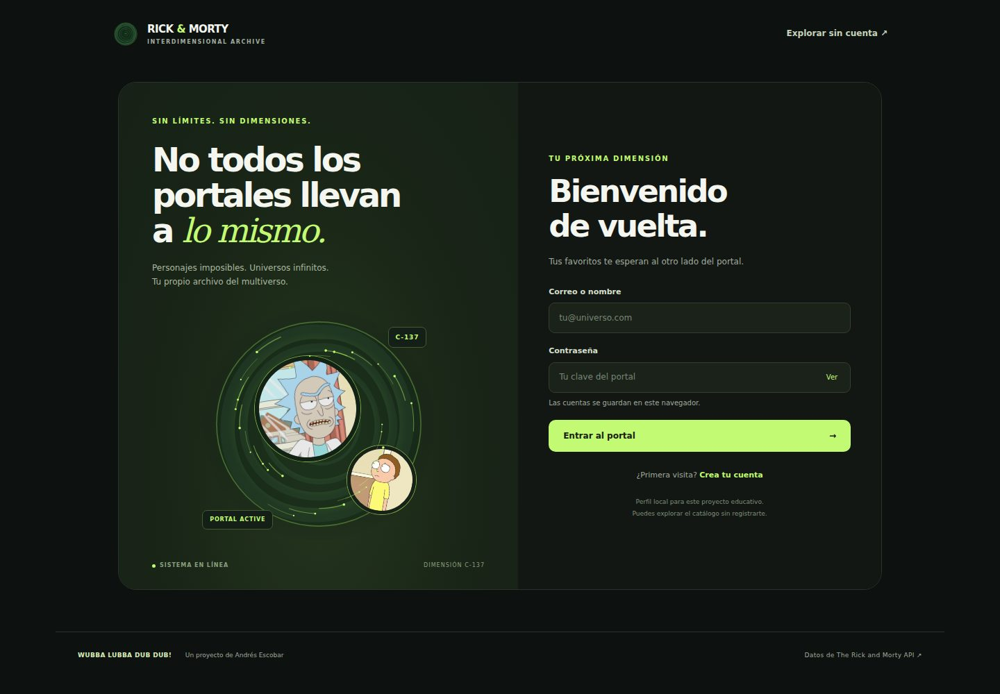
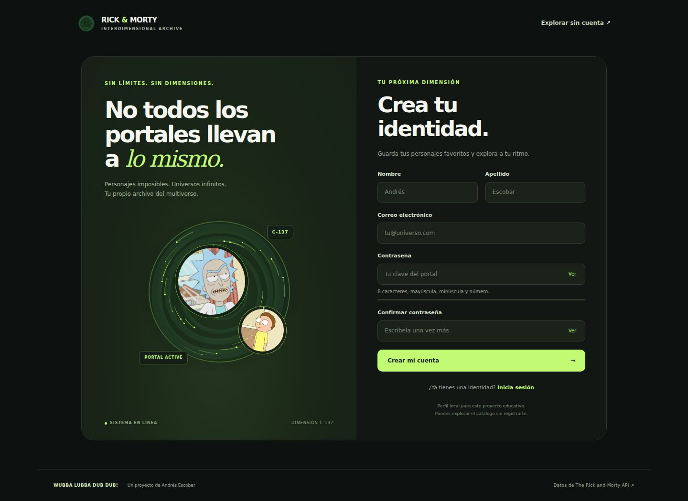
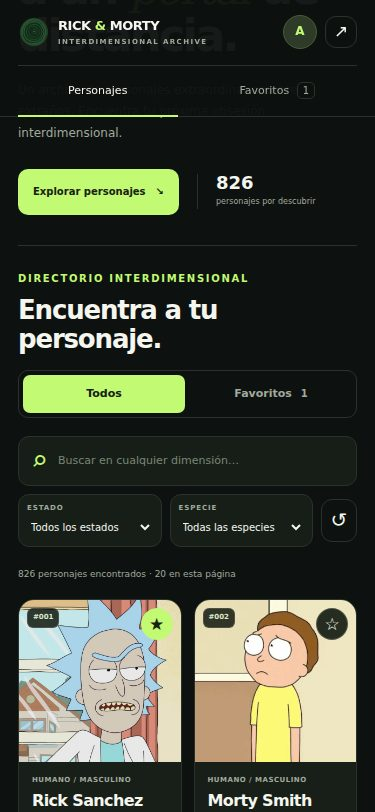
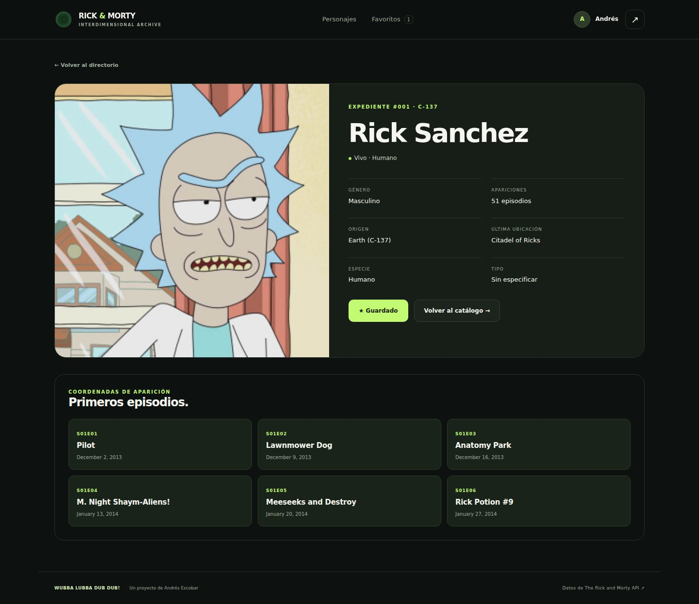

<div align="center">

# Rick & Morty · Interdimensional Archive

**Personajes extraordinariamente extraños. Una interfaz moderna para explorarlos.**

[Live Demo ↗](https://rckmtyaeea.xyz) · [Repositorio](https://github.com/andresescobar14/ProyectoRickAndMorty-Andres) · [API oficial](https://rickandmortyapi.com/documentation)

HTML · CSS · JavaScript · GSAP 3.15 · Canvas 2D

Proyecto educativo de **Andrés Escobar**. Sin frameworks de interfaz ni compilación necesaria para ejecutar el sitio.

</div>



## Qué incluye

| Función | Comportamiento |
| --- | --- |
| Catálogo completo | Paginación sobre The Rick and Morty API; 20 personajes por página. |
| Búsqueda y filtros | Nombre, estado y especie, con enlaces que conservan los filtros. |
| Favoritos | Colecciones separadas para invitados y para cada cuenta local. |
| Detalles | Estado, género, especie, origen, ubicación y primeros seis episodios. |
| Registro y login | Validaciones, contraseñas visibles/ocultas y feedback accesible. |
| Perfil | Edición de datos; el cambio de correo conserva los favoritos. |
| Animaciones | Entradas con GSAP, transiciones CSS y portal Canvas en los formularios. |
| Responsive | Catálogo, acceso, registro, detalles y perfil adaptados a móvil y escritorio. |

Puedes utilizar **Explorar sin cuenta** para entrar directamente al catálogo. Al registrarte, tu perfil y tus favoritos de cuenta quedan separados de la colección de invitado.

## Interfaz



<details>
<summary>Ver registro, móvil y detalle</summary>







</details>

## Ejecutar en tu equipo

```bash
git clone https://github.com/andresescobar14/ProyectoRickAndMorty-Andres.git
cd ProyectoRickAndMorty-Andres
python -m http.server 8080
```

Abre **http://localhost:8080**. En Windows puedes usar `py -m http.server 8080`.

También puedes abrir la carpeta en Visual Studio Code y ejecutar `index.html` con **Live Server**. Utiliza un servidor local: las funciones de cuenta requieren Web Crypto, disponible en HTTPS o localhost.

**No necesitas npm para ver el sitio.** GSAP se incluye localmente, los iconos del portal son SVG y la tipografía utiliza fuentes de sistema. Las tarjetas y los episodios necesitan conexión a la API.

## Desarrollo y pruebas

Requiere Node.js 18 o posterior y npm:

```bash
npm ci
npm run check
npm test
```

| Comando | Función |
| --- | --- |
| `npm run check` | Comprueba la sintaxis de los cuatro módulos de JavaScript. |
| `npm test` | Ejecuta pruebas de cuentas, favoritos, migración y consumo de API. |
| `npm run vendor` | Actualiza la copia local de GSAP desde la versión fijada en `package.json`. |

Después de actualizar GSAP, ejecuta `npm run vendor` y guarda `assets/vendor/gsap.min.js` junto con el lockfile. No se carga Tailwind ni GSAP desde un CDN en tiempo de ejecución.

## Animaciones y rendimiento

- **GSAP:** entradas breves que animan únicamente posición y opacidad. Un `IntersectionObserver` inicia las tarjetas visibles y deja de observarlas después.
- **Canvas:** solo aparece en login y registro en escritorio. Máximo de 26 partículas, resolución limitada a 1.5 veces el tamaño CSS y dibujo limitado a 30 FPS.
- El canvas se detiene al quedar fuera de la pantalla, cuando la pestaña está oculta o al activar `prefers-reduced-motion`. En móvil, el panel decorativo se oculta.
- Las animaciones respetan la preferencia de movimiento reducido. Si GSAP o las APIs de observación no están disponibles, el contenido sigue siendo visible.
- Las imágenes de las tarjetas utilizan carga diferida, dimensiones reservadas y decodificación asíncrona.
- Las búsquedas esperan 300 ms antes de consultar. `AbortController` cancela peticiones anteriores; una respuesta antigua no reemplaza la búsqueda nueva.
- Caché de API en memoria: hasta 24 respuestas durante cinco minutos. No se descarga el catálogo completo de una sola vez.
- Cada petición tiene un límite de 12 segundos y estados visibles de carga, ausencia de resultados y error con reintento.

Los límites reducen el trabajo de fondo; no garantizan una tasa de fotogramas idéntica en todos los equipos.

## Cuentas y almacenamiento

El registro y el login son una **simulación local para aprendizaje**, no autenticación de servidor. Un visitante con acceso a las herramientas del navegador puede modificar su almacenamiento; estos controles no protegen información ni recursos privados.

- Las cuentas se guardan en `localStorage` y la sesión en `sessionStorage`.
- Se almacena un hash PBKDF2 con salt independiente, no la contraseña en texto plano. No se rellena el campo de contraseña en el perfil.
- Los favoritos se asocian a un identificador estable de cuenta, por lo que cambiar el correo no los pierde.
- Las cuentas de la versión anterior que sigan en `sessionStorage` se migran al entrar, junto con sus favoritos.
- Borrar los datos del navegador elimina las cuentas y favoritos locales. No hay recuperación por correo ni sincronización entre dispositivos.
- Si el navegador bloquea el almacenamiento, se permite explorar como invitado y se avisa cuando los favoritos solo pueden durar la visita.

Para una aplicación con usuarios reales, sustituye este módulo por autenticación y almacenamiento de servidor, por ejemplo mediante Supabase o un backend propio.

## Organización

| Ruta | Responsabilidad |
| --- | --- |
| `index.html` | Registro y portal decorativo. |
| `login.html` | Acceso a la cuenta local. |
| `main.html` | Catálogo, filtros, favoritos y paginación. |
| `character.html` | Expediente del personaje y episodios. |
| `account.html` | Edición del perfil o acceso para invitados. |
| `styles.css` | Diseño, componentes, responsive y movimiento reducido. |
| `js/core.js` | Cuentas locales, validación, almacenamiento y favoritos. |
| `js/api.js` | Peticiones, errores, caché, cancelación y timeout. |
| `js/motion.js` | Entradas GSAP y ciclo de vida del canvas. |
| `js/app.js` | Controladores de páginas y eventos delegados. |
| `assets/` | GSAP, portal SVG e imágenes decorativas locales. |
| `tests/` | Pruebas automatizadas de lógica. |
| `docs/screenshots/` | Capturas de la interfaz. |
| `CNAME` | Dominio personalizado existente: `rckmtyaeea.xyz`. |

## Publicar y actualizar la demo

1. Integra la solicitud de cambios en **main** con **Merge pull request → Confirm merge**.
2. En **Settings → Pages**, configura publicación desde **main**, carpeta **/(root)**, si no estaba configurada.
3. Conserva el dominio personalizado de `CNAME` y su configuración DNS.
4. En **Actions**, espera a que **pages build and deployment** termine correctamente.
5. Abre [la demo](https://rckmtyaeea.xyz) y recarga con **Ctrl + Shift + R**.

La dirección de GitHub Pages del repositorio es https://andresescobar14.github.io/ProyectoRickAndMorty-Andres/ y puede redirigir al dominio personalizado.

## Comprobaciones

Las pruebas cubren registro, hashes, acceso, contraseñas con espacios, nombres duplicados, cambio de correo, separación de favoritos, migración, datos de almacenamiento inválidos, codificación de filtros, caché, errores 404/red, IDs inválidos, cancelación y lotes de episodios.

La revisión de navegador comprueba los formularios, el catálogo, la búsqueda, filtros, paginación, favoritos, detalle y perfil, además de ausencia de desbordamiento en 320, 375, 640, 768, 1024, 1440 y 1920 px. Los escenarios de errores de red se simulan para que las comprobaciones sean reproducibles.

## Accesibilidad

Etiquetas de formulario, indicadores `aria-pressed` en favoritos y pestañas, mensajes de estado, navegación por teclado, foco visible, enlace para saltar al contenido y respeto a movimiento reducido. Puedes pulsar **/** en el catálogo para enfocar la búsqueda.

## Créditos y alcance

- Datos e imágenes: [The Rick and Morty API](https://rickandmortyapi.com/).
- Animaciones: [GSAP](https://gsap.com/) · [licencia y condiciones](https://gsap.com/standard-license/).
- Personajes y marca Rick and Morty: sus respectivos titulares. Proyecto de fans sin afiliación oficial.

La disponibilidad de personajes, imágenes y episodios depende de la API externa. Este repositorio no incluye un backend ni estadísticas de usuarios reales.

**Autor:** [Andrés Escobar · @andresescobar14](https://github.com/andresescobar14)
